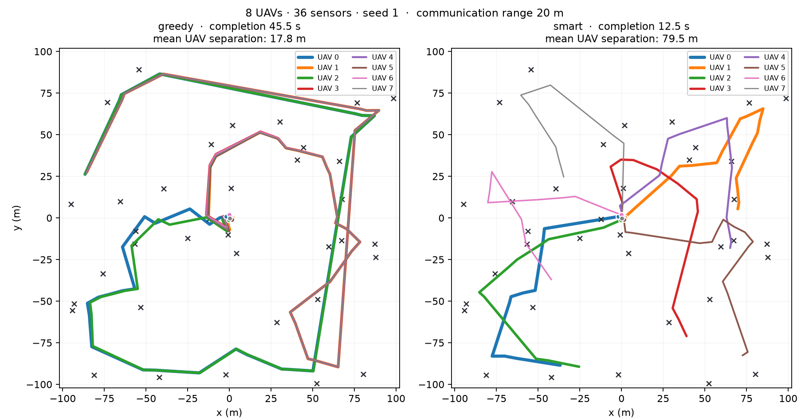

# uav-wnn — Coleta de dados por enxame de UAVs com redes sem peso e fusão de dados

Trabalho da disciplina **Fusão de Dados** — PESC/COPPE-UFRJ.
Raphael Nagao Ferreira · `rnagao@cos.ufrj.br`

---

## O que é

Reprodução do problema de coordenação de enxame de UAVs formulado por **Lamenza (2025, PUC-Rio)**, trocando **apenas o aproximador de função**: rede n-tuple sem peso (Katopodis, 2022, COPPE/UFRJ) no lugar das redes profundas do MADDPG. Depois da reprodução, o trabalho estende o problema para o domínio da disciplina: **medição ruidosa, filtro de informação, filtro de Kalman com entrada de controle e fusão distribuída por interseção de covariância**.

O princípio que rege o repositório está no [PRD §0](PRD.md):

> **O problema de Lamenza não é modificado.** Toda alteração exige uma linha na tabela de desvios (§5.4) e uma decisão registrada (§10).

E isso deixou de ser promessa: **o ambiente é o `GrADySEnvironment` de Lamenza, verbatim**, carregado de um submodule fixado na tag `dissertation`. Não há reimplementação do MDP. O `src/uavwnn/refenv/` apenas carrega, configura e semeia aquele código — nada altera observação, ação, recompensa, coleta ou terminação.

O simulador está fixado em **`gradysim==0.6.11`**: o `environment.py` de referência importa `VisualizationController`, que existe até essa versão e sumiu na série 0.7. Rodar código intacto contra outro simulador seria, por si só, uma divergência do baseline.

## Estado

| Spec | Estado |
|---|---|
| SPEC-00 — Ambiente de referência | **concluída**: 18 testes, P1 e P2 fechadas, validação contra a fig. 7.3 |
| SPEC-01 — Estudo de binarização | **concluída**: portão G0 fechado, codificador escolhido com evidência |
| SPEC-03 — Harness de custo | **T1 e T3 medidos**; T2 depende da SPEC-04 |
| SPEC-02, 07 | revisadas; **próximas**, rodam em paralelo |
| SPEC-04 a 06, 08 a 10 | revisadas |

**Escopo do ruído (D13):** apenas o **GPS do drone**. O canal do sensor saiu, e com ele o antigo bloco 2b, o filtro de informação, a hipótese H4 e as pendências TS3 e P3. O conteúdo de fusão permanece: KF com entrada de controle (Etapa 2) e interseção de covariância entre UAVs (Etapa 3).

## Resultados medidos

### A montagem está correta

A heurística gulosa **do próprio trabalho de referência**, no ambiente de referência, reproduz os tempos de conclusão da fig. 7.3 em **9 de 9 células** da grade: erro relativo mediano **1,7 %**, máximo 3,3 %, viés médio **+0,5 %** — sem tendência sistemática. Ver [`reports/spec00-parametros.md`](reports/spec00-parametros.md) §8.

Isso vale mais que qualquer teste unitário: se submodule, versão do simulador, configuração ou laço de avaliação estivessem errados, essa curva não fecharia.

### Custo: 1,8 a 5,2 h por núcleo

Para o orçamento de 50 M passos de Lamenza, contra 7 dias de GPU por célula no original. O PRD estimava 8–30 h; o real é menor, com folga. E a célula cara em horas de treino é **`Na = 1`**, não `Na = 8` — o contador de passos é `passos × Na`. Ou seja, a Etapa 1 é a mais cara do projeto. Ver [`reports/spec00-orcamento.md`](reports/spec00-orcamento.md).

### O custo: pico de RAM medido, não bytes de artefato

A figura de memória do projeto é o **pico de RSS** (`VmHWM`) do processo que carrega o modelo e decide — um processo por modelo, mesma observação, célula a2s24 (`scripts/spec03_latencia_memoria.py`). A comparação por **memória persistente** (bytes do artefato, por fórmula) foi retirada: respondia "quanto ocupa em flash", não "quanta RAM precisa ter para rodar".

| modelo (arcabouço) | pico total (média ± dp, 100 processos) | latência mediana |
|---|---|---|
| **WNN T=16 deploy** (NumPy) | **45,9 ± 0,1 MB** | **22,6 ± 0,3 µs** |
| **WNN T=32 deploy** (NumPy) | **53,3 ± 0,2 MB** | **25,2 ± 0,5 µs** |
| MADDPG 256×256 (PyTorch) | 506,0 ± 0,1 MB | 49,1 ± 0,8 µs |

O processo da WNN tem pico ~10× menor, mas quase todo o pico do MADDPG é o PyTorch (~496 MB só de imports); descontado o arcabouço, a rede sem peso acresce mais (o load constrói dicionários antes da LUT plana). Em computação a WNN ganha: **zero multiplicações em ponto flutuante no aproximador**, ~2× no relógio e vantagem de ciclos **condicional à classe de alvo** — 31× em x86, 86× em Cortex-M4F, **438× em Cortex-M0 sem FPU**. Ver [`reports/spec06-merito.md`](reports/spec06-merito.md).

*(Ressalva RNF-11: arcabouços diferentes dos dois lados — NumPy × PyTorch — dominam tanto o pico quanto a latência.)*

### O codificador binário: quantis por slot

A distribuição da observação depende fortemente do **índice do slot** — o sensor mais próximo concentra, o 12º espalha, com razão de amplitude **3,1×**. Binning global desperdiça bits justamente no slot 1, que é o que dirige a ação: usa 2,40 dos 4,00 bits disponíveis.

Medido pela clonagem do guloso (erro angular mediano): **quantil por slot 4,3°** contra 6,7° do linear por slot e 7,6° do global. Configuração escolhida: **E2, T=8, N=48** — 5,8° com 200 bits, melhor que o *melhor* resultado do global, que precisa de 400 bits e 128 RAMs. Ver [`reports/spec01-binarizacao.md`](reports/spec01-binarizacao.md).

### O baseline da figura publicada não coordena



A `greedy` — o baseline da fig. 7.3 — tem **separação média entre UAVs de 0,1 m**, contra alcance de comunicação de 20 m. Os drones voam colados, cobrindo o mesmo disco. Não é coordenação fraca; é ausência de coordenação.

A `smart`, do mesmo `heuristics.py`, coordena lendo **apenas o vetor de observação** — nenhuma informação privilegiada. No mesmo intervalo de decisão, `Ns = 24`, 60 sementes:

| Na | MADDPG publicado | `smart` medido | `greedy` medido |
|---|---|---|---|
| 2 | 29,6 | **25,18 ± 0,91** | 40,79 ± 2,07 |
| 4 | 13,8 | 16,12 ± 0,73 | 43,04 ± 2,21 |
| 8 | 9,7 | 10,21 ± 0,40 | 39,33 ± 2,51 |

**Uma heurística sem treino algum fica a 5–17 % do MADDPG e o supera com 2 agentes** — contra 32 dias de GPU. Isso muda a barra da H6 e está registrado como pendência **T4**.

## Etapas

Cada etapa acrescenta **uma única** fonte de dificuldade, para que qualquer degradação seja atribuível a uma causa identificada.

| Etapa | Configuração | Dificuldade nova | Hipóteses | Portão |
|---|---|---|---|---|
| 1 | 1 UAV, sem ruído | aproximação de função sobre entrada binarizada | H1 | G1 |
| **2** | 1 UAV, ruído no **GPS do drone** | KF com entrada de controle | H2, H3 | G2 |
| 3 | `Na` UAVs, com ruído | coordenação e erros correlacionados | H5, H6 | G3 |

A Etapa 2 roda em **um bloco** (D13): o ruído incide só no GPS do drone. O erro é deslocamento **comum** a todas as entradas da observação, porque toda entrada tem a forma `(p_k − p_i + S)/(2S)` — estrutura que a álgebra do filtro aproveita. A posição dos sensores permanece exata; a única costura é que o ranking por distância passa a sair da estimativa filtrada, nunca da verdade.

Como as features entram **sem tocar no cenário**, com os diagramas do fluxo: [`specs/ARQUITETURA.md`](specs/ARQUITETURA.md).

## Baseline MADDPG — como rodar

O submodule de referência traz os **pesos publicados** por Lamenza: 9 checkpoints
(`Na ∈ {2,4,8} × Ns ∈ {12,24,36}`, 45 MB), o código de treino e o harness de
avaliação. **Não é preciso treinar nada** — retreinar seriam ~7 dias de GPU por
célula.

`torch` é um grupo **opcional**, porque são ~200 MB só para ler os
`.cleanrl_model` (que são arquivos do `torch.save`):

```bash
uv sync --group baseline
git submodule update --init --recursive        # se ainda não fez
```

### 1. Tamanho do modelo e tempo de inferência — segundos

```bash
uv run --group baseline python scripts/spec02_baseline_maddpg.py
```

Lê os `state_dict` e mede o forward. Não roda o ambiente.

| `Na` | obs | params do ator | ator fp32 | mediana | mult. fp |
|---|---|---|---|---|---|
| 2 | 27 | 73 474 | 287,0 KB | 36,5 µs | 72 960 |
| 4 | 31 | 74 498 | 291,0 KB | 35,0 µs | 73 984 |
| 8 | 39 | 76 546 | 299,0 KB | 35,3 µs | 76 032 |

### 2. Tempo de conclusão e trajetórias — ~4 min

```bash
uv run --group baseline python scripts/spec02_maddpg_rollout.py --episodios 200
```

Roda a política no ambiente de referência, com a configuração do `test.py`
conferida parâmetro por parâmetro. Gera as 9 trajetórias em `reports/img/maddpg/`.

### 3. Campanha com média e desvio — ~2 a 3 h

```bash
uv run --group baseline python scripts/spec02_maddpg_campanha.py
```

**100 runs × 200 episódios × 9 células.** A estrutura é o ponto:

```
1 episódio  →  um tempo de conclusão
1 RUN       →  E = 200 episódios (o `total_runs` do test.py de Lamenza)
1 campanha  →  R = 100 runs, e o reportado é média ± desvio SOBRE AS RUNS
```

Cada run é uma **réplica da campanha de avaliação dele**, então o desvio mede
*quanto o número publicado variaria numa nova campanha* — não quanto um episódio
varia, que é ~14× maior.

**Em segundo plano**, porque são horas:

```bash
nohup uv run --group baseline python scripts/spec02_maddpg_campanha.py \
  > /tmp/campanha.log 2>&1 &

tail -f /tmp/campanha.log                                    # progresso e ETA
for f in reports/maddpg/*.csv; do \
  echo "$(basename $f): $(($(wc -l < $f)-1))/100"; done      # runs por célula
```

Pode interromper a qualquer momento — o CSV é gravado linha a linha, então você
perde no máximo uma run, e o cache retoma de onde parou.

**Variações:**

```bash
# rápido, mesmo formato: ~30 min
uv run --group baseline python scripts/spec02_maddpg_campanha.py --runs 20

# só as células que interessam (o padrão são as 9 da tab. 7.1)
uv run --group baseline python scripts/spec02_maddpg_campanha.py --celulas 4:24,8:36

# agrega o cache sem rodar nada — instantâneo
uv run --group baseline python scripts/spec02_maddpg_campanha.py --so-resumo
```

Como biblioteca, recebendo o array de cenários direto:

```python
import sys; sys.path.insert(0, "scripts")
from spec02_maddpg_campanha import campanha, CENARIOS_LAMENZA

campanha()                              # as 9 de Lamenza, 100 runs
campanha([(4, 24), (8, 36)], runs=30)   # subconjunto
```

Devolve `{(Na, Ns): {figura: (média, desvio)}}`, para encadear sem passar pelo CSV.

### Resultado da campanha, 900 runs

| célula | conclusão (s) | sucesso | separação (m) |
|---|---|---|---|
| `a_2-s_12` | 18,44 ± 0,71 | 0,9995 | 92,8 |
| `a_2-s_24` | 30,32 ± 2,37 | 0,9944 | 100,8 |
| `a_2-s_36` | 35,36 ± 2,19 | 0,9964 | 116,6 |
| `a_4-s_12` | 10,07 ± 0,13 | 1,0000 | 80,1 |
| `a_4-s_24` | 13,73 ± 0,15 | 1,0000 | 94,2 |
| `a_4-s_36` | 16,13 ± 0,14 | 1,0000 | 95,1 |
| `a_8-s_12` | **15,11 ± 0,47** | 0,9999 | 76,6 |
| `a_8-s_24` | 9,65 ± 0,08 | 1,0000 | 73,7 |
| `a_8-s_36` | 12,87 ± 0,16 | 1,0000 | 88,2 |

**Validação 3/3 dentro de um desvio** contra os valores publicados (29,6 / 13,8 /
9,7 em `Ns = 24`). Junto com a validação 9/9 do guloso, fecha o pipeline para
política aprendida **e** para heurística.

**Coordenação, com número:** o MADDPG separa os UAVs de 74 a 117 m; o `greedy`
mediu **~0,1 m** contra 20 m de alcance de comunicação. Duas a três ordens de
grandeza.

### Três ressalvas

1. **Não há checkpoint para `Na = 1`.** A Etapa 1 começa ali e não tem baseline
   MADDPG; pedir `--celulas 1:12` recusa em voz alta.
2. **A linha `Na = 2` é até 15× menos estável** que as outras (desvio entre runs
   de 2,37 s contra 0,15 s). Comparar a nossa política ali exige mais sementes.
3. **`a_8-s_12` é anômala** — 15,11 s, pior que células com mais sensores. Aquela
   pasta foi retreinada em set/2024 depois de um treino interrompido; é
   propriedade dos pesos publicados, não do nosso código.

Relatórios: [`reports/spec02-baseline-maddpg.md`](reports/spec02-baseline-maddpg.md)
e [`reports/spec02-baseline-maddpg-rollout.md`](reports/spec02-baseline-maddpg-rollout.md).

## Documentação

`docs/` explica **como as coisas funcionam**; `reports/` guarda **o que foi
medido**.

| | |
|---|---|
| [`docs/teoria/`](docs/teoria/) | fundamentação: as duas WNN, o MADDPG e o filtro de Kalman — equações, variáveis e a linha de código que implementa cada uma |
| [`docs/codebase.md`](docs/codebase.md) | a base inteira: 42 scripts, 45 módulos, 8 pipelines |
| [`docs/pipeline-treinamento.md`](docs/pipeline-treinamento.md) | o treino, do `env.step` até a escrita na LUT |
| [`reports/`](reports/) | um relatório por spec, mais os experimentos transversais |

## Instalação

Requer [uv](https://docs.astral.sh/uv/). O ambiente vem de um **submodule**:

```bash
git submodule update --init --recursive
uv sync
uv run pytest -q                    # 18 testes, ~1 min
```

## Scripts

| Script | O que faz |
|---|---|
| `spec00_demo.py` | um episódio com traço passo a passo; `--plot` salva trajetórias, `--compare` gera o painel greedy vs smart, `--estilo lamenza` reproduz o visual do `plot_paths.py` de referência |
| `spec00_visualizar.py` | **visualização 3D ao vivo** no navegador; `--diagnostico` testa o servidor sem navegador |
| `spec00_validar_guloso.py` | reproduz a fig. 7.3 nas 9 células |
| `spec00_budget.py` | custo de simulação por célula |
| `spec01_estudo.py` | estudo de binarização; escolhe o codificador com evidência |
| `spec03_custo.py` | harness de custo: T1 (tamanho) e T3 (operações) |
| `spec04_diferencial.py` · `spec04_diferencial_redes.py` | testes diferenciais contra o `Ramnet.jl` do Katopodis |
| `replica_katopodis_52.py` | replica §5.2.2 da dissertação: circular vs termômetro |
| **`spec05_circular.py`** | **portão da SPEC-05**: normal projetada contra gaussiana simples, em três instrumentos. Sai com código 0 só se o C2 vencer com IC separado |
| **`spec05_mountaincar.py`** | T-05.4(a): reprodução do Katopodis no `MountainCarContinuous-v0`, hiperparâmetros das tabelas A.3/A.6 verbatim. `--p13` mede `Σ` como desvio em vez de covariância |
| **`spec05_identidade.py`** | T-05.5: cobertura do canal de identidade sob binarização e efeito de `R` sobre a diferenciação entre UAVs |
| **`spec06_orcamento.py`** | T-06.0: vazão por célula e por parcela, `B_max`, e o veredito sobre P2. **Bloqueia as outras tarefas da SPEC-06** |
| **`spec06_bancos.py`** | bancos `test`/`val` disjuntos (§4.2), horizonte permissivo (P5) e a interação `max_seconds_stalled` × RF-02 |
| **`spec06_treinar.py`** | o treinador da campanha: réplicas 1a e 1b, um laço para as duas, com os artefatos da §4.7 |

### Os três aproximadores comparáveis contra o MADDPG

`uavwnn.agents.APROXIMADORES` seleciona por nome, e os três atravessam **o mesmo**
laço do Algoritmo 4.4, a mesma política e o mesmo bootstrap — trocar o laço junto
com o aproximador mediria duas coisas.

| nome | o que é | crítico | convenção |
|---|---|---|---|
| `mlp` | MLP densa `D→32→32→3`, NumPy puro | MLP | — |
| `ntupla` | **a nossa**: gradiente funcional (§4.3.1) | NTRN com esquecimento (§4.2.1) | média (eq. 4.12) |
| `ntupla_anbubus` | portada do `NTNModel` de [`anbubus/ntn_neurocomputing_v0`](https://github.com/anbubus/ntn_neurocomputing_v0) | gradiente funcional (mesma família) | **soma** |

O baseline do **problema** é outro e não entra nessa tabela: o MADDPG de Lamenza,
medido dos pesos publicados (256 × 256, 287–299 KB). Estes três são variações do
**método**, e cada um é um braço da comparação contra ele.

```bash
# a portagem do NTNModel é verificada contra o PyTorch deles (torch é só de teste)
uv run --group baseline pytest tests/test_anbubus.py -q
```

### Campanha das políticas WNN — mesmas figuras de mérito do MADDPG

`scripts/spec06_campanha_wnn.py` espelha `spec02_maddpg_campanha.py`: `R` runs por
célula, CSV como cache, média ± desvio **sobre as runs**, trajetórias no estilo
`plot_paths.py`, e as **mesmas colunas** — as tabelas juntam linha a linha.

```bash
uv run python scripts/spec06_campanha_wnn.py     --aproximador ntupla --checkpoint reports/ckpt/ntupla --runs 1000
```

**`--checkpoint` é obrigatório, e a razão não é burocracia.** Uma rede n-tuple vazia
prediz `f = 0` em todo estado, o que a normal projetada mapeia num rumo constante —
e isso rende uma linha de CSV completa, plausível e **sem significado**. Rodar sem
modelo exige `--sem-treino-proposital`, que marca `treinado=False` em cada linha.
O treino no ambiente real é a **SPEC-06**; este script é o arnês de avaliação dela.

Custo medido (0,56 s/episódio em `Na=2, Ns=12`), para dimensionar antes de lançar:

| escopo | CPU sequencial |
|---|---|
| 1000 runs × 200 episódios, 1 célula (`2:12`) | ~31 h |
| 1000 runs × 200 episódios, **as 9 células** | **~37 dias** |
| 1000 runs × 20 episódios, as 9 células | ~89 h |

As runs são independentes e o CSV é cache, então dá para paralelizar por célula e
retomar de onde parou.

### Quarto braço: treinar com o PPO do RLlib, usando o código publicado

`vendor/ntn_neurocomputing_v0` é o submodule de
[`anbubus/ntn_neurocomputing_v0`](https://github.com/anbubus/ntn_neurocomputing_v0),
o repositório do artigo *"Functional gradient descent for n-tuple regression"*
(Neurocomputing 500, 2022). O `NTNModel` dele é usado **como está**, com o PPO do
Ray RLlib — que é o que o artigo diz ter usado.

**São dois passos, em dois ambientes, e isso não é escolha:** `ray[rllib]` fixa
`gymnasium==1.2.2` no máximo e este projeto exige `>=1.3.0` — incompatíveis.

```bash
git submodule update --init vendor/ntn_neurocomputing_v0

# 1. treino, em ambiente efêmero (não importa `uavwnn`)
uv run --isolated --with "ray[rllib]" --with torch --with pettingzoo --with numpy     python scripts/spec06_ppo_anbubus.py --celula 2:12 --passos 1000000     --bruto reports/ckpt/ppo-a2s12-bruto.npz

# 2. conversão para NumPy, no ambiente do projeto (verificada, tolerância 1e-5)
uv run python scripts/spec06_importar_ppo.py     reports/ckpt/ppo-a2s12-bruto.npz reports/ckpt/ppo-a2s12

# 3. campanha, como qualquer outro checkpoint
uv run python scripts/spec06_campanha_wnn.py --aproximador ntupla_anbubus     --checkpoint reports/ckpt/ppo-a2s12 --celulas 2:12 --runs 1000
```

A fronteira por arquivo coincide com o que a **RNF-11** já exigia: torch no treino,
NumPy puro na medição. A conversão é exata (desvio medido `0,00e+00`) e só é
defensável porque `tests/test_anbubus.py` prova que as duas implementações são
numericamente a mesma.

**Duas ressalvas medidas, e ambas mudam expectativas:**

- **As configurações do repositório deles não rodam verbatim** no Ray atual:
  `tune.run` depreciado, `sgd_minibatch_size`→`minibatch_size`,
  `num_sgd_iter`→`num_epochs`, `local_mode` removido, e é preciso desativar
  explicitamente a nova pilha de API (o `ModelCatalog`/`TorchModelV2` que o
  `NTNModel` usa só existe na antiga).
- **O PPO do RLlib treina uma gaussiana diagonal direta sobre `(θ, s)` com
  recorte** — isto é, o **C0** da SPEC-05 §4.3, que o portão mediu perdendo do C2
  por 13,45° com IC a 12 MDEs de zero. O braço PPO herda esse modo de falha, e a
  campanha usa a política **certa** para o checkpoint (a diagonal, não a normal
  projetada) — avaliar com a errada produziria ações plausíveis e sem relação com o
  que foi treinado.
| **`spec02_baseline_maddpg.py`** | baseline MADDPG: tamanho e latência dos pesos publicados (**precisa `--group baseline`**) |
| **`spec02_maddpg_rollout.py`** | baseline MADDPG: tempo de conclusão e trajetórias |
| **`spec02_maddpg_campanha.py`** | baseline MADDPG: `R` runs por cenário, média ± desvio, CSV como cache |

```bash
uv run python scripts/spec00_demo.py --policy smart --plot traj.png
uv run python scripts/spec00_demo.py --compare greedy-vs-smart.png
uv run python scripts/spec00_demo.py --agents 2 --sensors 12 --estilo lamenza --plot path-a2s12.png
uv run python scripts/spec00_visualizar.py --policy greedy

# SPEC-05 — o portão da ação circular. Código de saída 0 só se o C2 vencer.
uv run python scripts/spec05_circular.py --sementes 3 --tentativas 20000

# SPEC-05 — reprodução do Katopodis e canal de identidade (rodam em ~1 h cada)
uv run python scripts/spec05_mountaincar.py --episodios 1500 --sementes 5
uv run python scripts/spec05_identidade.py --tentativas 15000 --sementes 3

# baseline MADDPG (ver a seção própria acima)
uv run --group baseline python scripts/spec02_maddpg_campanha.py --so-resumo
```

Um episódio em três linhas:

```python
from uavwnn.refenv import LAMENZA_003, load_heuristics, run_episode

cfg = LAMENZA_003(num_drones=4, num_sensors=24)
greedy = load_heuristics().create_greedy_heuristics(3, 12)
print(run_episode(cfg, greedy, seed=1).as_row())
```

### Visualização 3D ao vivo

O simulador sobe um servidor **WebSocket** em `localhost:5678`. Ele fala apenas WebSocket e **não serve página** — abrir `localhost:5678` no navegador dá *"You cannot access a WebSocket server directly with a browser"*.

Quem serve a página é o visualizador hospedado, e é ele que conecta no seu servidor:

```
https://project-gradys.github.io/gradys-sim-nextgen-visualization/
```

Use **Chrome ou Edge**: a página é HTTPS e precisa abrir um WebSocket inseguro em `localhost`. O Chrome permite por tratar `localhost` como origem confiável; o Firefox costuma bloquear.

Se não conectar, isole o problema sem depender do navegador com `--diagnostico`: ele conecta como cliente WebSocket em Python e imprime os quadros recebidos. Se passar, o servidor está bom e o problema é do navegador.

## Documentos

| Arquivo | O que é |
|---|---|
| [`PRD.md`](PRD.md) | Requisitos, hipóteses, MDP, figuras de mérito, cronograma, decisões |
| [`PENDENCIAS.md`](PENDENCIAS.md) | Registro único das pendências, ordenadas por impacto |
| [`specs/ARQUITETURA.md`](specs/ARQUITETURA.md) | Como as features entram sem tocar no cenário, com os diagramas |
| [`specs/`](specs/) | 11 specs de execução, cada uma com critério de saída **medido** |
| [`specs/REVISAO.md`](specs/REVISAO.md) | Revisão cruzada das specs (registro de um momento) |
| [`reports/`](reports/) | Relatórios com números medidos e as figuras |

## Proveniência

Os valores do cenário vieram do **código de referência** (`Project-GrADyS/gradys-data-collection@dissertation`, cenário `003-collaboration`), não do texto da dissertação, sempre que os dois divergem. Proveniência linha a linha em [`reports/spec00-parametros.md`](reports/spec00-parametros.md), incluindo três ressalvas que precisam acompanhar qualquer citação dos números publicados:

- `algorithm_iteration_interval` é **0,5 s** no código, contra 2 s na tab. 7.1 — e 2 s é fisicamente inconsistente com `communication_range = 20 m`, porque a 15 m/s o UAV atravessaria a cobertura de um sensor entre dois heartbeats;
- a observação é **normalizada** e o padding é **`-1`**, não `(0,0)` — o que torna desnecessário o bit de validade que o projeto havia previsto;
- na fig. 7.3 o MADDPG é avaliado a 0,5 s por decisão e o guloso a **0,1 s**, uma variável não controlada que vale ~10 % no tempo de conclusão.

## Implementação de referência do aproximador

Além do ambiente, o **aproximador** também tem fonte primária em código: [`rkatopodis/RLWorktable.jl`](https://github.com/rkatopodis/RLWorktable.jl) e [`rkatopodis/Ramnet.jl`](https://github.com/rkatopodis/Ramnet.jl), do próprio Katopodis, MIT. O núcleo está na branch **`faster_hashing`** do segundo, não na `master`.

A leitura dele mostrou que **ator e crítico são modelos diferentes** — `FunctionalDiscriminator` (média simples, sem esquecimento) e `RegressionDiscriminator` (auto-normalizado, com esquecimento e contador) —, o que fechou uma pendência que estava mal formulada, e que **ele não trata ação circular**, o que confirma o `θ` do nosso problema como questão nova.

## Referências

- LAMENZA, T. S. *A Deep Reinforcement Learning Approach for Sensor Data Collection by a Swarm of UAVs*. Dissertação de mestrado, PUC-Rio, 2025.
- KATOPODIS, R. F. *Reinforcement Learning with Weightless Neural Networks*. Dissertação de mestrado, COPPE/UFRJ, 2022.
- LOWE, R. et al. *Multi-Agent Actor-Critic for Mixed Cooperative-Competitive Environments* (MADDPG), 2017.
- NG, A. Y.; HARADA, D.; RUSSELL, S. *Policy invariance under reward transformations*, 1999.
- JULIER, S.; UHLMANN, J. *A non-divergent estimation algorithm in the presence of unknown correlations*, 1997.

As dissertações de Lamenza e Katopodis **não** estão versionadas: são obras de terceiros. As citações no PRD e nas specs referenciam seção, equação e página.
