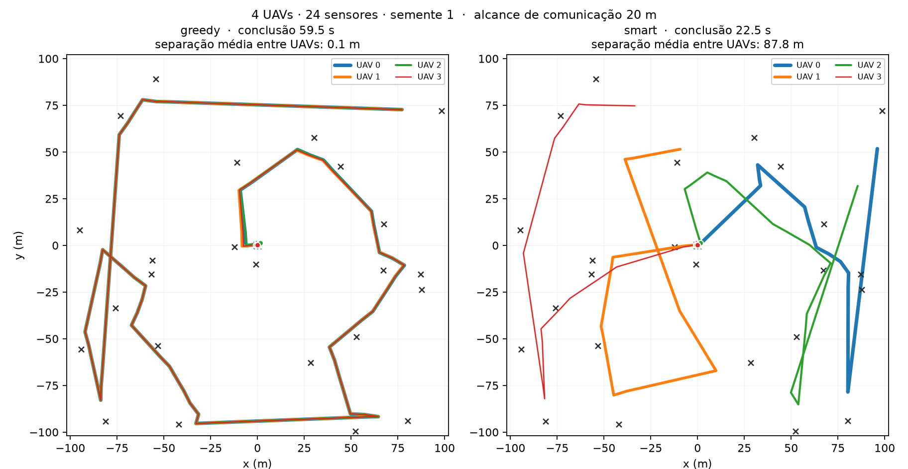

# SPEC-00 — Ambiente de referência: proveniência e ressalvas

**O ambiente do trabalho é o de Lamenza, verbatim.** Não há reimplementação. O código vem do submodule `vendor/gradys-data-collection`, fixado na tag `dissertation` (`be94ca7`), cenário `003-collaboration`.

Nosso código (`src/uavwnn/refenv/`) apenas **carrega, configura e semeia** aquele ambiente. Nada nele altera observação, ação, recompensa, coleta ou terminação.

---

## 1. Por que não reimplementamos

A primeira versão desta spec reimplementou o MDP e provou, por teste diferencial, que era equivalente ao original (`max|Δobs| = 7,9 × 10⁻⁸`, `Δrecompensa = 0`, em 60 passos × 5 sementes).

**Ainda assim foi descartada.** O motivo é uma medição feita naquele processo: uma "correção" aparentemente inócua — inicializar `current_position` na posição de spawn em vez de `(0,0,0)`, que é o que o original faz — fazia a divergência de observação saltar de **7,9 × 10⁻⁸ para 8,5 × 10⁻¹** em 60 passos. A causa não é magnitude, é **caos**: a posição errada entra no cálculo da escala do waypoint, altera levemente o rumo da primeira ação, e as trajetórias divergem por completo.

Se uma linha desse porte tem esse efeito, manter uma implementação paralela é superfície de risco permanente contra o único ativo que o trabalho tem: a comparabilidade com o baseline. O ambiente passa a ser o deles.

---

## 2. Versão do simulador — e por que ela importa

**`gradysim==0.6.11`**, fixado.

O `environment.py` de referência importa `VisualizationController`. Verificado por inspeção dos wheels do PyPI:

| versão | `VisualizationController` |
|---|---|
| 0.6.9, 0.6.10, 0.6.11 | **presente** |
| 0.7.0, 0.7.1, 0.7.3–0.7.5, 0.8.0 | ausente |

Rodar o código intacto contra outra versão do simulador seria, por si só, uma divergência do baseline — e exigiria patches no arquivo de referência, que é justamente o que se quer evitar. Sob 0.6.11 o arquivo importa e roda **sem nenhuma alteração**.

`tests/test_refenv.py` trava as duas coisas: o commit do submodule e a versão do gradysim.

---

## 3. Parâmetros: onde cada valor foi encontrado

Fonte de mecanismo: `scenario/003-collaboration/`. Fonte de valores: `benchmark.py` (treino) e `visualize_performance.py` (avaliação) — **não** os defaults do `main.py`, que são de teste.

| Parâmetro | Valor | Proveniência | Pendência |
|---|---|---|---|
| `communication_range` | **20 m** | `environment.py:157` | **P1** |
| Período do heartbeat | **`0,99 × interval`** | `environment.py:102` | **P5** |
| Raio da área de largada | **2 m** (quadrado) | `environment.py:533` | **P6** |
| Tratamento de borda | destino limitado a `[-100,100]²` | `environment.py:71-95` | **P8** |
| Agregação sem sucesso | censura em `max_episode_length` | `environment.py:674` | **L1** |
| Recompensa de equipe | mesmo escalar para todos | `environment.py:646` | Q9 |
| `N*_s`, `N*_a` | 12 e `Na − 1` | `benchmark.py` | tab. 7.1 |
| Modo de recompensa | `punish` = eq. 5-6 | `benchmark.py` | eq. 5-6 |
| `min_sensor_priority` | 1 | `benchmark.py` | — |
| `total_timesteps` | 50 000 000 | `benchmark.py` | §7.2 |
| `algorithm_iteration_interval` | **0,5 s** | `benchmark.py` | ver §4.1 |
| Arquitetura do ator do MADDPG | *pendente* | `main.py`, via CLI | **P4** |

---

## 4. Ressalvas sobre os números publicados

Estas não são divergências nossas — são propriedades do trabalho de referência que precisam ser declaradas ao citarmos a fig. 7.3.

### 4.1 `algorithm_iteration_interval`: 2 s no texto, 0,5 s no código

A tab. 7.1 diz **2 s**; o `benchmark.py` passa `--algorithm-iteration-interval=0.5`.

Além de o código ser a fonte que gerou os resultados, **2 s é fisicamente inconsistente com `communication_range = 20 m`**: a 15 m/s o UAV percorre 30 m entre heartbeats e atravessaria a cobertura de um sensor sem coletá-lo.

### 4.2 Treino e avaliação usam configurações diferentes

| Fase | Script | `end_when_all_collected` | `interval` |
|---|---|---|---|
| Treino | `benchmark.py` | **False** (`--no-end-when-all-collected`) | 0,5 |
| Avaliação da política | `visualize_performance.py` | **True** (default; não é passado) | 0,5 |
| Avaliação da heurística | `visualize_performance.py` | **True** | **0,1** |

No treino o episódio continua após a coleta completa — é o "longer duration positive reward signal" de Lamenza §5. Na avaliação ele termina na conclusão, e é esse instante que vira o `completion_time` da fig. 7.3.

### 4.3 A comparação da fig. 7.3 tem uma variável não controlada

No mesmo script, **o MADDPG é avaliado a 0,5 s por decisão e o guloso a 0,1 s** — cinco vezes mais reativo, com integrador de mobilidade proporcionalmente mais fino.

Medido por nós, guloso na célula 4×24, 8 sementes pareadas:

| Configuração | tempo de conclusão |
|---|---|
| guloso a `interval = 0,5` | 43,45 s |
| guloso a `interval = 0,1` | **39,13 s** |

O guloso mais reativo é **~10 % mais rápido**. O efeito favorece o baseline, então a vantagem publicada do MADDPG sobre ele é **conservadora** — mas a assimetria existe e será declarada sempre que citarmos aqueles números. Coberto por `test_avaliar_guloso_a_0_1_e_mais_rapido`.

---

## 5. O que o nosso código acrescenta, e por que não é modificação

| Acréscimo | Por quê | Toca o MDP? |
|---|---|---|
| Carregamento por caminho de arquivo | Não poluir o espaço de importação e deixar explícito que o código é externo | não |
| `EnvConfig` com os valores publicados | Evitar que os defaults de teste do `main.py` entrem por engano | não |
| `random.seed(seed)` antes de `reset()` | O `reset()` de referência declara o argumento `seed` e **o ignora**; sorteia com o `random` da stdlib. É a única forma de reproduzir cenários sem tocar no arquivo | não |
| Poda de handlers de logging | O `Simulator` acrescenta um `StreamHandler` ao logger raiz por instância e nunca o remove; sem `reset()`, cada episódio constrói um. 10 000 episódios = 10 000 handlers | não |
| Condição de parada do laço | Verbatim do `visualize_performance.py`: quebra na **primeira** `info` não vazia. Capturar a última daria o fim do episódio, não a conclusão | não |

---

## 6. Características do ambiente que a SPEC-01 precisa conhecer

Estas mudam o desenho do codificador binário e foram descobertas ao ler o código:

1. **A observação é normalizada**: `(p_k − p_i + S)/(2S)`. A entrada vive em **[0,1]** para valores válidos, não em `[-200,200]` metros.
2. **O padding é `-1`**, fora da faixa dos válidos. Logo "slot vazio" e "sensor exatamente sobre o UAV" (que normaliza para 0,5) são distinguíveis **por construção** — o bit de validade que a SPEC-01 projetava é **desnecessário**.
3. **Ressalva de faixa:** `p_k − p_i` vive em `[-2S, 2S]`, então a normalização produz `[-0,5, 1,5]`, e não `[0,1]`. O `observation_space` de referência declara `Box(-1,1)`, o que também não bate. A SPEC-01 precisa binarizar a faixa **real**.
4. O índice do agente entra como `k / Na`.

---

## 7. Pendências remanescentes

| # | Pendência | Situação |
|---|---|---|
| **P4** | Arquitetura do ator do MADDPG | `main.py` a recebe por CLI; falta extrair o default |
| **P7** | `max_episode_length` "permissivo" do §7.1 | Cenário exploratório é outro (`001-prototype`/`002-scaling`) |
| **P9** | `σ_sensor` | Parâmetro nosso, da Etapa 2 |
| **V-1** | Invariante KS contra o gerador analítico | Depende da SPEC-01. Agora compara contra o ambiente de referência diretamente |

---

## 8. Validação contra os resultados publicados

A prova de que a montagem está correta: a heurística gulosa **do próprio trabalho de referência**, rodando no ambiente de referência, reproduz os tempos da fig. 7.3. Nenhuma política aprendida é necessária — se o guloso bate, então submodule, versão do simulador, configuração e laço de avaliação estão todos certos.

Configuração espelhada de `visualize_performance.py`: `algorithm_iteration_interval = 0,1` para a heurística, `end_when_all_collected` no default `True`, quebra na primeira `info` não vazia. 200 episódios por célula.

| Na | Ns | medido (s) | IC95 | publicado (s) | erro |
|---|---|---|---|---|---|
| 2 | 12 | 29,89 | [29,10; 30,67] | 29,6 | +1,0 % |
| 2 | 24 | 37,51 | [36,46; 38,56] | 38,2 | −1,8 % |
| 2 | 36 | 43,30 | [41,99; 44,61] | 43,2 | +0,2 % |
| 4 | 12 | 29,12 | [28,25; 29,99] | 28,2 | +3,3 % |
| 4 | 24 | 35,73 | [34,53; 36,93] | 35,4 | +0,9 % |
| 4 | 36 | 38,62 | [37,01; 40,24] | 39,7 | −2,7 % |
| 8 | 12 | 28,41 | [27,49; 29,33] | 27,6 | +2,9 % |
| 8 | 24 | 33,77 | [32,47; 35,06] | 33,2 | +1,7 % |
| 8 | 36 | 36,34 | [34,74; 37,94] | 36,7 | −1,0 % |

**9/9 células dentro de 10 %.** Erro relativo mediano **1,7 %**, máximo 3,3 %, viés médio **+0,5 %** — sem tendência sistemática. Taxa de sucesso 1,000 em todas.

Os valores publicados foram lidos das figuras (`statistics/completion_times/*.png`), com precisão de leitura de ~0,3 s; o script de referência não semeia o gerador. O acordo dentro de ~2 % é o esperado para uma reprodução correta.

Reprodução: `uv run python scripts/spec00_validar_guloso.py`. Três células (a diagonal) estão travadas em `tests/test_refenv.py::test_guloso_reproduz_a_figura_7_3`.

---

## 9. Achado: o baseline da fig. 7.3 não coordena, e há um que coordena no mesmo repositório

O `heuristics.py` de referência traz **três** políticas: `greedy`, `random` e `smart`. A fig. 7.3 compara o MADDPG apenas contra a `greedy`.

As trajetórias no estilo exato do `plot_paths.py` de referência — incluindo a faixa semitransparente de **40 m em unidades de dados**, que é o diâmetro do alcance de comunicação varrido — estão em [`img/paths/`](img/paths/), com o mesmo esquema de nomes da pasta `statistics/paths/` do repositório de referência. Gerar com `--estilo lamenza`.

*Mesma semente, mesmo cenário, mesma observação. As trajetórias da `greedy` são desenhadas com largura decrescente por UAV justamente para que as de baixo apareçam — sem esse cuidado o gráfico mostraria só o último drone e esconderia o achado. Gerados por `uv run python scripts/spec00_demo.py --compare ARQUIVO.png`.*

**A `greedy` não coordena — nem um pouco.** Medido na célula 4×24, semente 1: a **separação média entre pares de UAVs ao longo do episódio é de 0,1 m**, contra um alcance de comunicação de 20 m. Os quatro drones voam em formação, colados, cobrindo o mesmo disco. Não é uma heurística de coordenação fraca; é ausência de coordenação. Reproduz exatamente o que Lamenza observa no §7.1 (fig. 7.1): as trajetórias se sobrepõem porque todos partem do mesmo ponto e escolhem o mesmo sensor mais próximo.

A `smart` atribui sensores entre os agentes por um laço guloso de troca, **lendo apenas o vetor de observação** — nenhuma informação privilegiada. É exatamente o "baseline 3: guloso + reivindicação entre agentes" que o PRD §6.1 listava como indispensável, e ele já existe.

**Comparação no mesmo intervalo de decisão (0,5 s), `Ns = 24`, 60 sementes:**

| Na | MADDPG publicado | `smart` medido | `greedy` medido | separação entre UAVs (greedy) |
|---|---|---|---|---|
| 2 | 29,6 | **25,18 ± 0,91** | 40,79 ± 2,07 | ~0 m |
| 4 | 13,8 | 16,12 ± 0,73 | 43,04 ± 2,21 | ~0 m |
| — | — | 11,5 (8×36, semente 2) | 55,0 (8×36, semente 2) | ~0 m |
| 8 | 9,7 | 10,21 ± 0,40 | 39,33 ± 2,51 | ~0 m |

**Uma heurística sem nenhum treino fica a 5–17 % do MADDPG, e o supera com 2 agentes** — contra 32 dias de GPU. E o baseline efetivamente usado na figura é 2,4 a 4,3× pior que ela.

*(Valores do MADDPG lidos das barras das figuras publicadas, precisão ~0,3 s. A comparação é sobre o mesmo ambiente e o mesmo intervalo de decisão.)*

### Consequência para o trabalho

**A barra da H6 muda.** "A coordenação emerge: o enxame supera a heurística gulosa" é afirmação fraca quando a gulosa são quatro drones em formação. A barra honesta é a **`smart`**, e ela é dura: bater a `smart` significa bater algo que já empata com o MADDPG.

Isto não enfraquece o projeto — ao contrário, é o tipo de resultado que a disciplina de baselines do PRD existe para produzir: *"sem eles, 'a rede sem peso completou a coleta' não significa nada"*. Mas exige três coisas:

1. Reportar `greedy`, `smart` e a política aprendida **sempre juntas**, nunca só contra a `greedy`.
2. Declarar que a comparação publicada usa o baseline que não coordena.
3. Reformular a H6 em torno da `smart`, ou dividi-la: superar a `greedy` (barra baixa, provável) e superar a `smart` (barra alta, incerta).
