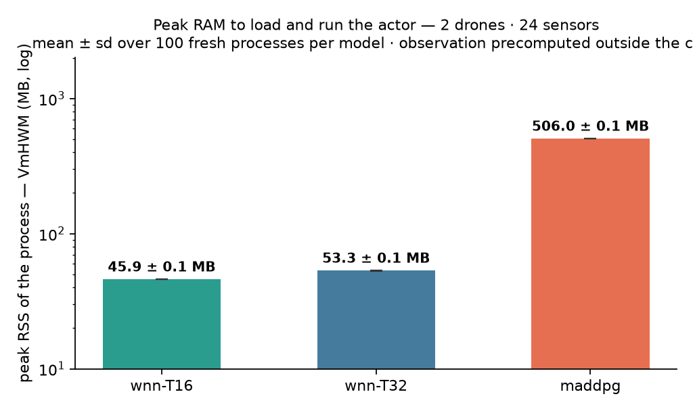

# Latência e pico de RAM — 2d/24s, medidos

Gerado por `scripts/spec03_latencia_memoria.py` em 2026-09-10 · x86_64 · mesma observação para os três · um processo por modelo · menor mediana de 8×1000.

## Tempo de inferência (decisão completa: obs → ação)

| modelo | mediana | p99 |
| --- | --- | --- |
| wnn-T16 | 22.1 µs | 78.3 µs |
| wnn-T32 | 24.7 µs | 65.5 µs |
| maddpg | 48.6 µs | 213.7 µs |

- wnn-T16 é **2.2×** mais rápida que o MADDPG

- wnn-T32 é **2.0×** mais rápida que o MADDPG

## Pico de RAM do processo (VmHWM)

| modelo | arcabouço | pico total | acréscimo do modelo | RSS pós-carga |
| --- | --- | --- | --- | --- |
| wnn-T16 (NumPy) | 32.1 MB | **50.7 MB** | 18.6 MB | 40.4 MB |
| wnn-T32 (NumPy) | 30.9 MB | **53.0 MB** | 22.1 MB | 40.5 MB |
| maddpg (PyTorch) | 508.0 MB | **511.1 MB** | 3.1 MB | 504.5 MB |

- **pico total**: a marca d'água alta de RSS do processo ao fim do laço de inferência — o que o dispositivo precisa ter de RAM para carregar o modelo e decidir. É a figura de memória do projeto;
- **arcabouço**: o pico depois dos imports e antes de qualquer peso — NumPy na WNN, NumPy + PyTorch no MADDPG. É custo real de quem implanta com aquele arcabouço, mas é biblioteca, não rede;
- **acréscimo do modelo**: `pico total − arcabouço` — quanto carregar a rede (com os transientes do load: na WNN, a rede de dicionários que vira LUT plana) e executá-la eleva o pico;
- **RSS pós-carga**: o residente estável com o modelo carregado, após `malloc_trim` — o que FICA, não o pico;
- o simulador fica fora: a observação é calculada no processo pai e lida pelos filhos de um `.npy`.

