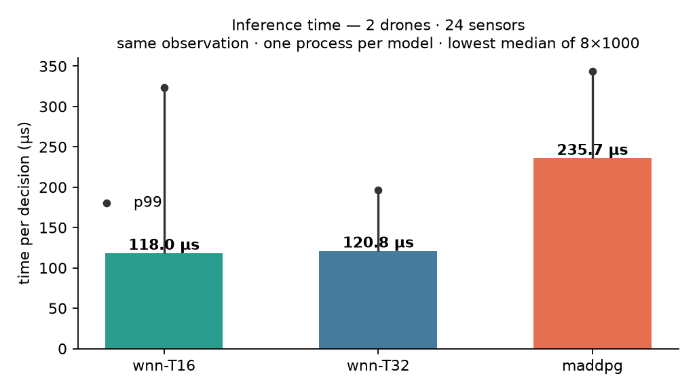
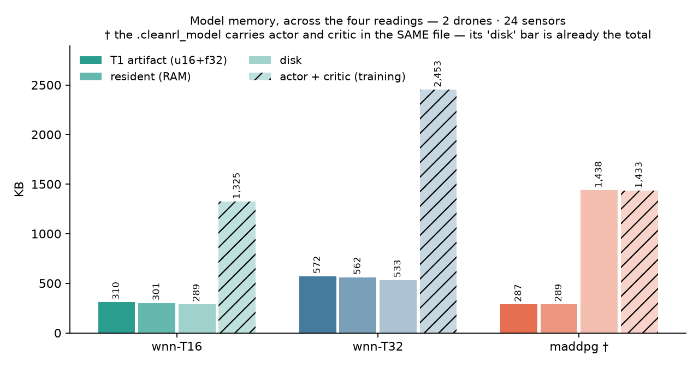

# Latência e memória — 2d/24s, medidos

Gerado por `scripts/spec03_latencia_memoria.py` em 2026-09-05 · x86_64 · mesma observação para os três · um processo por modelo · menor mediana de 8×1000.

## Tempo de inferência (decisão completa: obs → ação)

| modelo | mediana | p99 |
| --- | --- | --- |
| wnn-T16 | 118.0 µs | 323.2 µs |
| wnn-T32 | 120.8 µs | 196.8 µs |
| maddpg | 235.7 µs | 343.6 µs |

- wnn-T16 é **2.0×** mais rápida que o MADDPG

- wnn-T32 é **2.0×** mais rápida que o MADDPG

## Memória, nas quatro leituras (KB)

| modelo | T1 artefato | residente (RAM) | disco | ator + crítico |
| --- | --- | --- | --- | --- |
| wnn-T16 | 310 | 301 | 289 | 1,325 |
| wnn-T32 | 572 | 562 | 533 | 2,453 |
| maddpg † | 287 | 289 | 1,438 | 1,433 |

- **T1 artefato**: chave `uint16` + valores `float32` — a definição da SPEC-03, comparável com as demais tabelas do projeto;
- **residente**: o que ocupa RAM executando — na WNN, a `LUTPlana` (bitmap de ocupação + rank + valores, mapeamento, limiares) + buffers de trabalho; com o bitmap ele fica ABAIXO do T1, que modela chave `uint16` explícita por entrada. No MADDPG, pesos + entrada e ativações (2×256) que o forward usa. Sem os buffers do MADDPG a comparação seria assimétrica: o T1 da WNN embute os dela;
- **disco**: o arquivo como está; † o `.cleanrl_model` traz ator E crítico no mesmo arquivo, a barra dele já é o total;
- **ator + crítico**: o custo de treino — o crítico não voa.

## Arcabouço em RAM (antes de qualquer peso)

| modelo | imports |
| --- | --- |
| wnn-T16 | 17 MB |
| wnn-T32 | 17 MB |
| maddpg | 467 MB |

