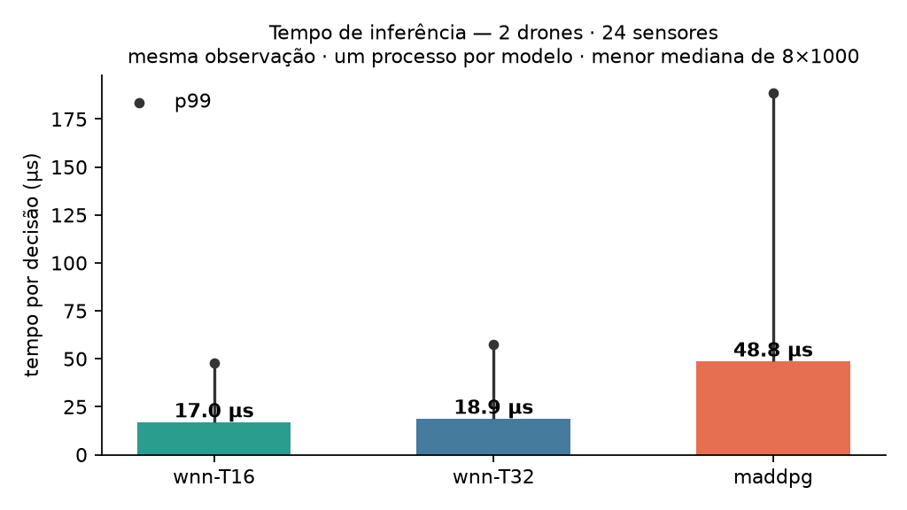
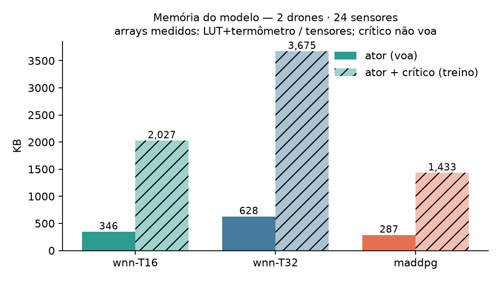

# Latência e memória — 2d/24s, medidos

Gerado por `scripts/spec06_latencia_memoria.py` em 2026-08-27 · x86_64 · mesma observação para os três · um processo por modelo · menor mediana de 8×1000.

## Tempo de inferência (decisão completa: obs → ação)

| modelo | mediana | p99 |
| --- | --- | --- |
| wnn-T16 | 17.0 µs | 48.0 µs |
| wnn-T32 | 18.9 µs | 57.7 µs |
| maddpg | 48.8 µs | 188.6 µs |

- wnn-T16 é **2.9×** mais rápida que o MADDPG

- wnn-T32 é **2.6×** mais rápida que o MADDPG

## Memória, nas quatro leituras (KB)

| modelo | T1 artefato | residente (RAM) | disco | ator + crítico |
| --- | --- | --- | --- | --- |
| wnn-T16 | 296 | 346 | 276 | 2,027 |
| wnn-T32 | 537 | 628 | 500 | 3,675 |
| maddpg † | 287 | 287 | 1,438 | 1,433 |

- **T1 artefato**: chave `uint16` + valores `float32` — a definição da SPEC-03, comparável com as demais tabelas do projeto;
- **residente**: o que a `LUTPlana` ocupa executando — chave global `int32` (não cabe em 16 bits), mapeamento das tuplas e limiares;
- **disco**: o arquivo como está; † o `.cleanrl_model` traz ator E crítico no mesmo arquivo, a barra dele já é o total;
- **ator + crítico**: o custo de treino — o crítico não voa.

## Arcabouço em RAM (antes de qualquer peso)

| modelo | imports |
| --- | --- |
| wnn-T16 | 17 MB |
| wnn-T32 | 17 MB |
| maddpg | 482 MB |

