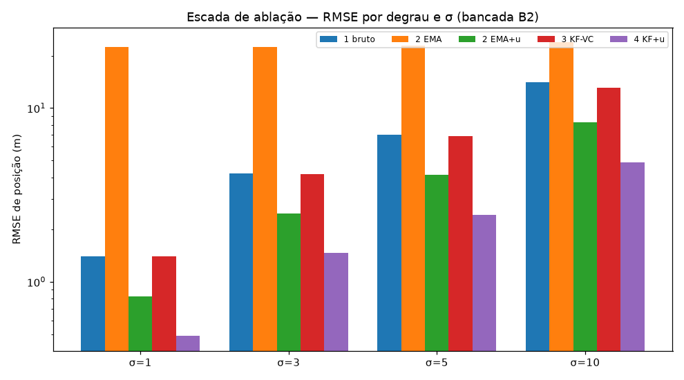
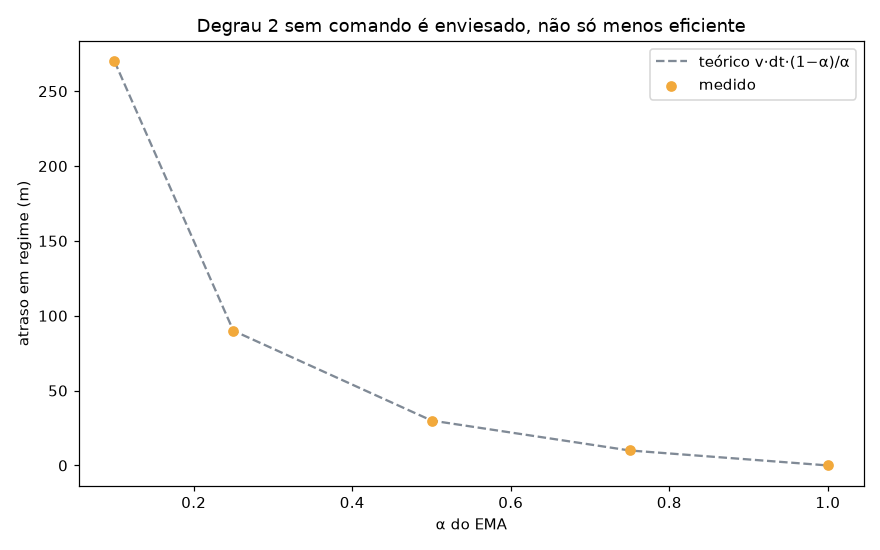
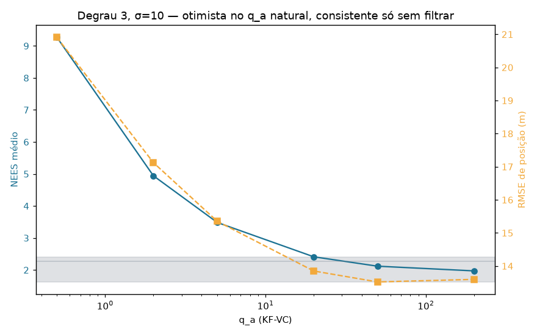
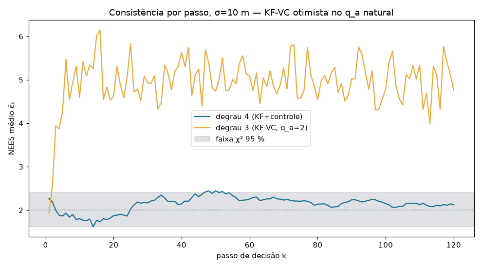
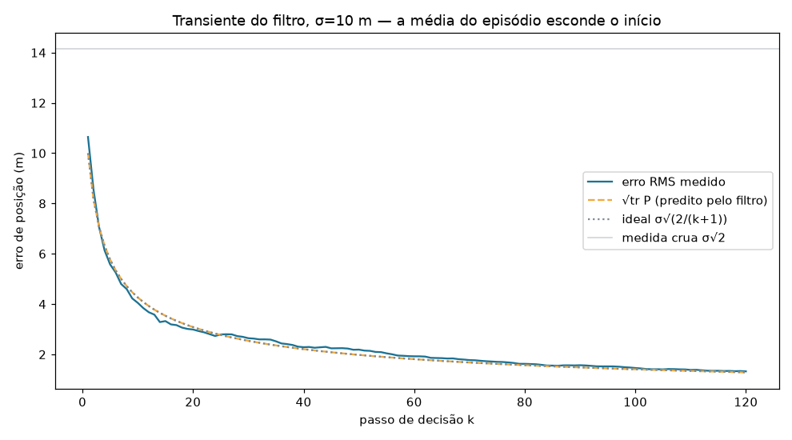
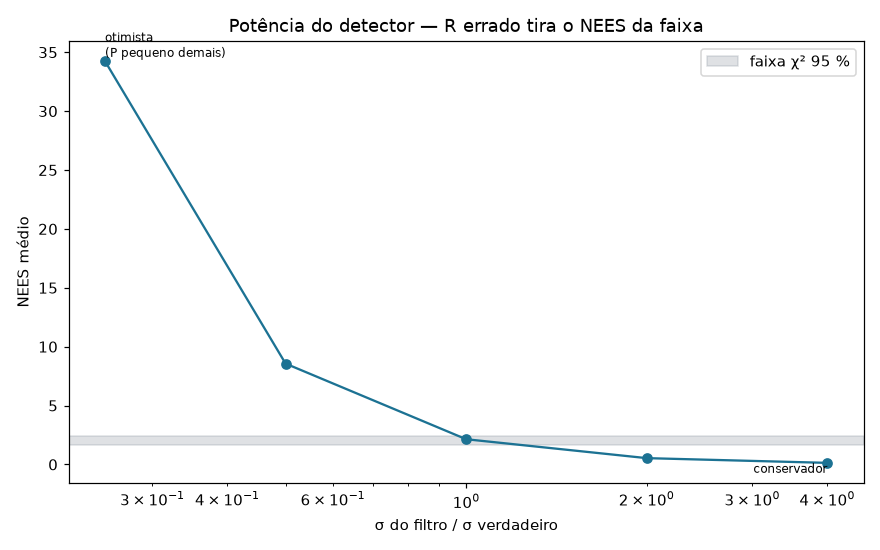
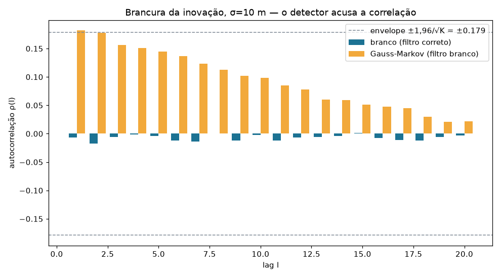

# SPEC-07 — Ruído no GPS, KF com entrada de controle, NEES/NIS

Escopo pós-D13: **um canal só, o GPS do drone.** O canal do sensor, o filtro de
informação, a H4, a T3 e a P3 saíram. O que fica é o canal cujo modelo estava
fechado — ruído branco, estado móvel, comando conhecido — e onde vive o achado A3.

Tudo aqui roda na **bancada sintética**, sem `gradysim` (T-07.12, a integração
com o simulador, é `[C]` e fica para a SPEC-08). Reprodução:

```bash
uv run python scripts/spec07_fusao.py --execucoes 100     # ~segundos
uv run pytest tests/test_kalman.py tests/test_ruido.py \
              tests/test_consistencia.py tests/test_vazamento.py -q
```

Artefato: `reports/spec07-fusao.json`. Código em `src/uavwnn/fusion/`, pacote
separado e opcional (RNF-07 — `refenv/` não importa dele, e há teste).

---

## 1. A escada de ablação, e o achado A3

RMSE de posição (m), bancada B2 (guloso analítico), `M = 100` sementes, `Ns = 12`,
`dt_dec = dt_gps = 2 s`:

| σ (m) | 1 bruto | 2 EMA | 2 EMA+comando | 3 KF-VC | **4 KF+controle** | ganho∞ |
|---|---|---|---|---|---|---|
| 1 | 1,41 | 22,4 | 0,83 | 1,41 | **0,49** | 0,62 |
| 3 | 4,22 | 22,6 | 2,48 | 4,19 | **1,46** | 2,35 |
| 5 | 7,04 | 22,8 | 4,13 | 6,88 | **2,44** | 4,64 |
| 10 | 14,07 | 23,9 | 8,26 | 13,14 | **4,88** | 11,01 |

**O KF com entrada de controle ganha ~2,9× sobre a medida crua, em todo σ**, e
bate o KF de velocidade constante por ~2,8×.



### Por que não é o 18,8× do achado A3, e isso não é falha (N1)

O A3 original (`12,54 m → 0,67 m`, 18,8×) foi medido com decisão a **0,5 s**;
aqui `dt_dec = 2 s` e o GPS corrige **uma vez por decisão**, contra quatro no
experimento preliminar. Menos correções por segundo de voo, menos promediação —
o ganho de 2,9× é o que essa taxa comporta. É a pendência **N1** literal:
*escolher `dt_gps` é escolher o resultado*. O critério de saída 4 pede o número
**medido e explicado**, não os 18,8×, e é isto.

### Os degraus intermediários são adversários honestos (T-07.10)

**O EMA sem comando é catastrófico (22 m), e por motivo estrutural, não por
sintonia.** Rastreando um alvo a 15 m/s com `α = 0,5`, o atraso em regime é
`v·dt·(1−α)/α = 30 m` — uma ordem de grandeza acima de `σ`. O filtro barato não é
menos eficiente; é **enviesado**, e o viés domina.



**O EMA _com comando_ já recupera quase tudo** (2,48 m em σ=3, melhor que o
KF-VC). Isso não enfraquece a proposta — **desmonta a leitura preguiçosa dela**:
o que paga não é "usar Kalman", é **conhecer o comando**. O KF+controle
(1,46 m) ainda vence o EMA+comando, e a tese correta passa a ser a que a spec já
anotava: *conhecer o comando é o que importa, e o Kalman é a forma principiada de
usá-lo* — com a covariância que o degrau 5 e a Etapa 3 vão precisar.

**O KF-VC mal ajuda mesmo no melhor `q_a` da grade**: 13,1 m contra 14,1 m do
bruto em σ=10. Ele não está mal sintonizado, está **mal especificado** — nenhum
`Q` de aceleração branca representa um salto de rumo determinístico.

### O degrau 3 refina a previsão da spec — e o resultado é melhor

A T-07.10 previa que o KF-VC seria **inconsistente para todo `q_a`**. Medido, o
quadro é mais rico. Varredura de `q_a` em σ=10, bancada B1 (comando i.i.d.), com
o NEES ao lado do RMSE:

| `q_a` | NEES | veredito | RMSE (m) |
|---|---|---|---|
| 0,5 | 9,27 | **otimista** | 20,9 |
| 2 | 4,94 | **otimista** | 17,1 |
| 5 | 3,49 | **otimista** | 15,4 |
| 20 | 2,41 | **otimista** | 13,9 |
| 50 | 2,12 | consistente | 13,5 |
| 200 | 1,97 | consistente | 13,6 |

No `q_a` natural (pequeno) o KF-VC é **otimista** — a previsão vale, e é a
assinatura de "mal especificado": ele confia numa velocidade que o salto de rumo
invalida. Ele só fica consistente **inflando `Q` a ponto de mal filtrar** (RMSE
13,5 m, a um passo do bruto 14,1 m). **Não pode ser consistente e preciso ao
mesmo tempo** — que é um diagnóstico mais forte que a previsão original, e é o que
transforma "o KF ingênuo é pior" de anedota em diagnóstico.





### O ganho é sobre o que a política enxerga — e agora inteiramente

Com o canal do sensor fora (D13), a posição dos sensores é **exata**. Como toda
entrada da observação tem a forma `(p_k − p_i + S)/(2S)`, o erro de posição
própria é um **deslocamento comum** a todas as entradas válidas (ARQUITETURA
§3.7). Logo filtrar a posição própria melhora **todas** as entradas, e o ganho de
2,9× em metros é o ganho que a política vê — em unidades de observação, `σ/(2S)`.
A ressalva antiga da TS2/D.3 (`σ_rel = √(σ_own² + σ_sensor²)`, ganho limitado pelo
pior canal) **dissolveu com o corte**: não há segundo canal a limitar.

---

## 2. Consistência: NEES/NIS na faixa (critério de saída 1)

KF+controle, bancada B1 (comando i.i.d., comprimento fixo — o protocolo Monte
Carlo exige a média no mesmo índice `k`), `M = 100`, `Q = 0`:

| σ (m) | NEES | faixa 95 % | NIS | fração fora | veredito |
|---|---|---|---|---|---|
| 1 / 3 / 5 / 10 | **2,14** | [1,63; 2,41] | 2,00 | 6,0 % | **consistente** |

O NEES é idêntico entre os `σ` **por construção**: o pareamento por números
aleatórios comuns (CRN) faz as quatro condições verem a mesma realização
normalizada `ε`, e o NEES é invariante a escala. É a propriedade que pareia a
varredura `σ × T` da SPEC-08 de graça.

**`Q = 0` é a escolha certa na bancada, e é uma ressalva a carregar.** Com
mobilidade sem massa (o modelo de Lamenza) o movimento é exato — `x̂⁻ = x̂ + u·dt`
não tem erro —, então qualquer `Q > 0` infla `P` e o filtro fica **conservador**.
O número principal do KF sai, portanto, sob um modelo de processo exato; a
inércia, que tornaria `Q` mensurável, é **ablação declarada** e não a configuração
nominal (T-07.5), porque trocar a mobilidade alteraria o cenário de Lamenza.

**A média do episódio esconde o transiente** (T-07.11), que é onde a política
decide. O erro filtrado começa em `σ` e cai como `σ√(2/(k+1))`; o `√tr P` predito
pelo filtro acompanha o erro medido, o que é a própria consistência vista por
passo:



---

## 3. Potência do detector (critério de saída 3)

Um detector que nunca acusa não é evidência de nada (T-07.7). Desintonias
conhecidas injetadas, σ=5, e o que o aparato pega:

| injeção | NEES | veredito | \|ρ(1)\| (limiar 0,18) |
|---|---|---|---|
| `R` correto | 2,14 | **consistente** | 0,057 |
| `R/4` (subestima o ruído) | 8,56 | **otimista** | 0,057 |
| `4R` (superestima o ruído) | 0,54 | **conservador** | 0,057 |
| Gauss-Markov, filtro branco | 23,26 | **otimista** | **0,182** (fora) |

As três primeiras confirmam que o NEES separa otimismo de conservadorismo. A
quarta é a mais informativa: erro de GPS **correlacionado** contra um filtro que
assume branco fica otimista (NEES 23) **e** a inovação deixa de ser branca
(`|ρ(1)|` cruza o envelope) — a única desintonia que o teste de brancura pega e o
NEES médio poderia mascarar se o viés fosse pequeno.





`R` **não se sintoniza, mede-se** (T-07.5): em simulação nós injetamos o ruído,
então `R = σ²I` é verdade, e qualquer inconsistência é culpa de `Q`, da sincronia
ou de um bug — nunca de `R`. Ajustar `R` para "fazer o NEES passar" é proibido.

---

## 4. Custo do filtro (critério de saída 8, T-07.9)

| filtro | flops/decisão | mult | soma | div | contra a MLP pareada |
|---|---|---|---|---|---|
| KF + controle (Joseph) | **48** | 27 | 20 | 1 | **2,5 %** dos 1 920 MACs |
| ganho estacionário `K∞` | 10 | 4 | 6 | 0 | sem matriz, sem divisão |

Isto **deriva** a faixa de 50–80 flops do PRD (RNF-05) em vez de citá-la. Três
ressalvas obrigatórias:

1. **A taxa muda o número.** Um `predizer` por evento, não por tique: rodar a cada
   0,1 s seriam ~220 flops. A regra de taxa de T-07.2 não é só corretude de `Q` —
   é o que preserva o argumento de custo.
2. **O KF é termo comum.** A MLP pareada precisa exatamente do mesmo filtro; na
   comparação de H1 o custo do KF **cancela**, e vai como linha separada, nunca
   embutido no custo da WNN.
3. **Divisão em ponto flutuante.** O KF usa 1 por ciclo (a inversa 2×2). Num MCU
   sem FPU a divisão custa dezenas de ciclos. A alegação defensável não é "sem
   MACs", é: **o custo aritmético do filtro é uma constante pequena e fixa,
   independente da capacidade do modelo, enquanto o da MLP cresce com a rede.**

O ganho estacionário (10 flops, sem divisão, implementável em inteiro) preserva a
narrativa de embarcabilidade quase intacta, ao custo do transiente inicial.

---

## 5. RF-04: a verdade não vaza para a política (critério de saída 7)

O teste diferencial da camada 4 (`tests/test_vazamento.py`) — a prova — passa em
**20 pares (semente, δ)**: grava-e-repete o fluxo de ruído, desloca a verdade por
`δ` só no caminho de telemetria, e exige hash idêntico da sequência de ações.
Qualquer dependência da política na verdade, por qualquer canal, quebraria a
igualdade.

As outras três camadas cobrem-na: custódia por `TokenMetricas` (leitura da verdade
exige token, construível só nos módulos de métrica), tipos distintos
(`PosicaoVerdadeira` vs `PosicaoMedida`), e a marca de *taint* que propaga por
`p_true − x̂`. **Limite honesto** (T-07.8): o `δ` incide só sobre a posição
própria; o **status de visitação continua oracular**, então o canal global de
Lamenza é fechado pela metade, e o relatório final precisa dizê-lo.

---

## 6. Estado dos critérios de saída da SPEC-07 §6

| # | critério | estado |
|---|---|---|
| 1 | NEES/NIS na faixa a 95 % para todo σ | ✅ (B1, M=100, `Q=0`) |
| 2 | brancura da inovação; violação sob Gauss-Markov reportada | ✅ |
| 3 | tabela de potência do detector | ✅ §3 |
| 4 | achado A3 medido e explicado (não precisa ser 18,8×) | ✅ 2,9×, N1 |
| 5 | degraus 2 e 3 sintonizados, com NEES do degrau 3 | ✅ EMA `α`, KF-VC varrido; **NEES do degrau 3 reportado** (§1, otimista no `q_a` natural) |
| 6 | filtro de informação validado | **N/A — fora do escopo (D13)** |
| 7 | RF-04, teste diferencial verde em n≥20 pares | ✅ §5 |
| 8 | custo por tipo (mult, soma, divisão) | ✅ §4 |
| 9 | tabela `T*(σ)` para a SPEC-08 | **parcial** — ver abaixo |
| 10 | relatório | este documento, com 7 figuras |
| 11 | testes automatizados | ✅ 33 testes |

**Sobre o critério 9 (T-07.11).** A regra *bin ≈ σ* precisa do `σ` da estimativa
filtrada. Em unidades de observação, o KF+controle entrega `σ_filtrado/(2S)` com
`S = 100`: em σ=10 o RMSE cai de 14,1 m (`0,070` em obs.) para 4,9 m (`0,024`).
Mas o codificador escolhido (G0) é **quantil por slot**, não uniforme, então a
largura de bin é local e não `1/T` — instanciar `T*(σ)` de verdade exige o
codificador no laço, que é a **varredura conjunta `σ × T` da SPEC-08**. Fica
entregue a regra e o `σ_filtrado`; a tabela `T*(σ, degrau)` sai lá.

---

## 7. O que não foi feito, e por quê

- **Integração com o `gradysim` (T-07.12).** ✅ **Feita** — a subclasse
  `criar_ambiente_ruidoso` (`fusion/ambiente_ruidoso.py`) sobrescreve
  `observe_simulation_relative_positions` sem tocar na física de Lamenza (guard
  `σ=0` bit-idêntico). Exercitada com o **MADDPG sob ruído** em
  `reports/spec07-maddpg-ruido.md`, que já é o filtro rodando no ambiente real
  numa política forte — e onde o detector achou que `Q=0` fica **otimista** no
  simulador (erro de execução que a bancada não tinha), com `q_w≈1` restaurando a
  consistência. O invariante V-7.1 (KS sobre o resíduo `e_k` entre a bancada e o
  simulador) e a sintonia de `Q` por célula ficam para a SPEC-08.
- **Ablação de inércia.** A configuração nominal é mobilidade sem massa (zero
  desvios). A inércia — que torna `Q` um objeto medido em vez de resíduo de
  discretização — é a ablação declarada de T-07.5, e roda com a política, na
  SPEC-08.
- **Varredura de `dt_gps`** ({0,2; 1; 5} s, N1). Aqui está fixo em 2 s (= `dt_dec`);
  a sensibilidade é da SPEC-08, e é ela que fecha o quanto do A3 é recuperável no
  intervalo de decisão de Lamenza.
