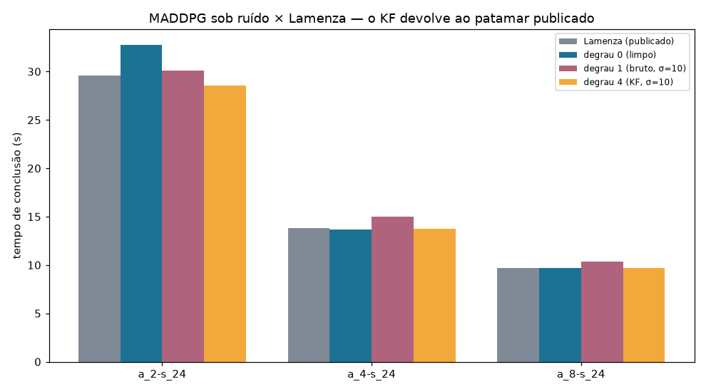
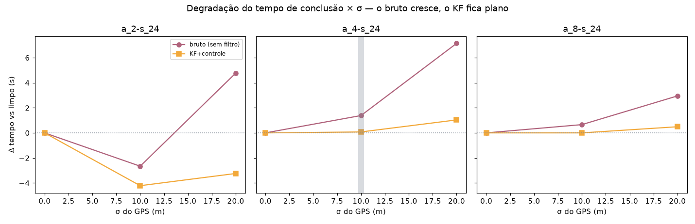
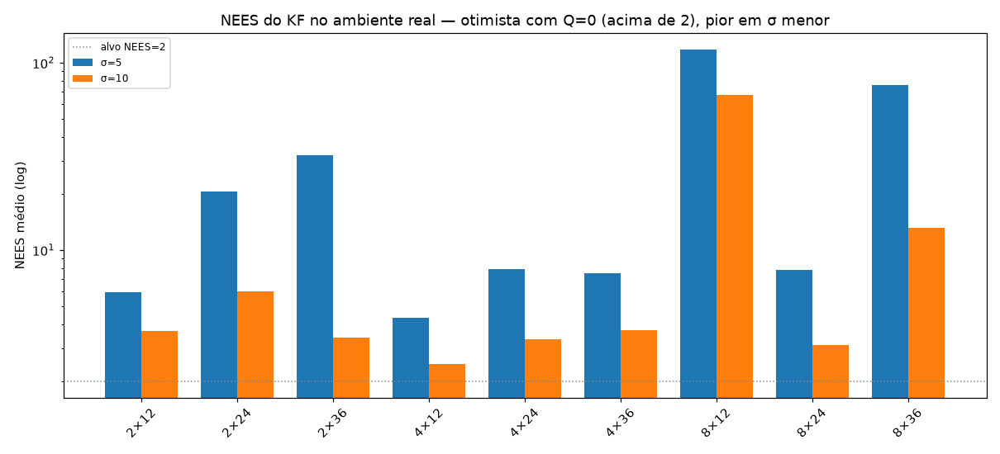
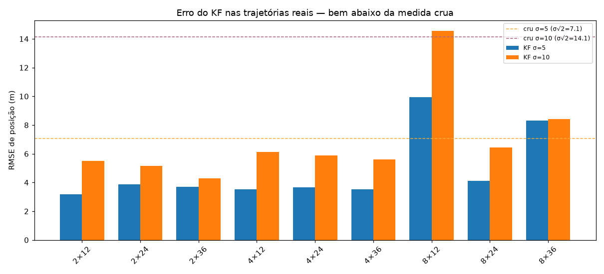
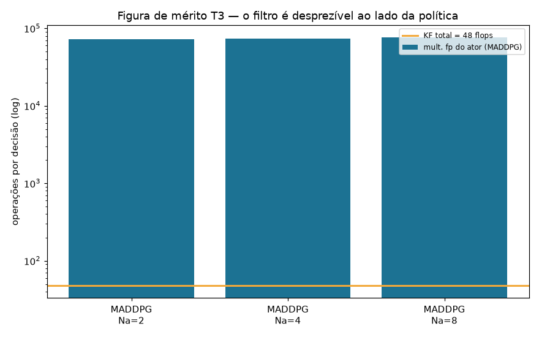

# SPEC-07 — o filtro de Kalman avaliado no MADDPG sob ruído

O experimento da bancada (`spec07-fusao-local.md`) validou o filtro sobre comando
sintético e guloso analítico. Aqui ele é exercitado numa **política forte e
pronta, no ambiente real** — o MADDPG dos pesos publicados —, o que testa a
costura de integração (T-07.12) e, principalmente, expõe o filtro a um erro de
modelo que a bancada não tinha.

```bash
uv run --group baseline python scripts/spec07_maddpg_ruido.py --sigmas 5,10 --episodios 20
```

Artefato: `reports/spec07-maddpg-ruido.json`. A costura é a subclasse
`criar_ambiente_ruidoso` (`src/uavwnn/fusion/ambiente_ruidoso.py`), que sobrescreve
**só** `observe_simulation_relative_positions` — a física de Lamenza fica intocada,
e com `σ = 0` a observação é bit-idêntica à do ambiente puro (`tests/test_ambiente_ruidoso.py`).

## Três rótulos, antes dos números

1. **Isto é H3 (fusão), não H1.** O MADDPG é referência de literatura (D7), não
   baseline pareado. O que se mede é *o KF devolve uma política ao regime sem
   ruído?*, numa política competente.
2. **Não há checkpoint para `Na = 1`** — as células são `Na ∈ {2,4,8}`, com ruído
   só no GPS próprio (Etapa 2, D13), não o canal correlacionado da Etapa 3.
3. **Regime L→R** (treino limpo → avaliação ruidosa): o MADDPG nunca viu ruído; o
   KF é o que o transfere sem retreino.

## Comparação com Lamenza: o KF devolve o MADDPG ao patamar publicado

A pergunta direta — *quanto o ruído de GPS degrada o MADDPG publicado, e o filtro
o recupera?* — nas três células com valor publicado (`Ns = 24`), 100 episódios
**pareados** por cenário, diferença por bootstrap pareado (o A/A da SPEC-02).
Reprodução: `scripts/spec07_maddpg_vs_lamenza.py`.

**Primeiro, a montagem se valida: o degrau 0 (limpo) reproduz Lamenza.**

| célula | Lamenza | degrau 0 (limpo) |
|---|---|---|
| a_2-s_24 | 29,6 | 32,7 * |
| a_4-s_24 | 13,8 | 13,6 |
| a_8-s_24 | 9,7 | 9,7 |

\* `a_2-s_24` é a célula **instável** (a campanha de 900 runs da SPEC-02 deu
30,3 ± 2,4 s, variância entre runs ~15× a das outras); 32,7 com 100 episódios
cai dentro dessa dispersão.

**σ = 10 (topo da grade) — o KF recupera 83–100 % do estrago:**

| célula | d1 bruto | Δ(d1−d0) | d4 KF | Δ(d4−d0) | KF recupera |
|---|---|---|---|---|---|
| a_2-s_24 | 30,1 | −2,7 [−16,8; +2,5] * | 28,5 | −4,2 [−14,7; +1,0] | +1,55 [+0,8; +2,3] |
| a_4-s_24 | 15,0 | **+1,4** [+1,0; +1,9] | 13,7 | +0,1 [−0,3; +0,5] | **95 %** |
| a_8-s_24 | 10,4 | **+0,7** [+0,4; +0,9] | 9,7 | +0,0 [−0,3; +0,3] | **100 %** |

Nas duas células estáveis o ruído bruto degrada com IC separado de zero, e o
degrau 4 **volta ao degrau 0** (Δ(d4−d0) contém zero — indistinguível do limpo).
Em `a_2-s_24` a comparação marginal é engolida pela variância do próprio cenário
(a célula instável), mas a diferença **pareada** `d1−d4` continua conclusiva
(+1,55 s): o pareamento remove a variância de cenário e o ganho do KF aparece.

**σ = 20 (estresse, fora da grade declarada) — a degradação fica grande e o KF
ainda recupera ~85 %:**

| célula | d1 bruto | Δ(d1−d0) | d4 KF | Δ(d4−d0) | KF recupera |
|---|---|---|---|---|---|
| a_2-s_24 | 37,5 | +4,8 [−5,2; +10,6] * | 29,5 | −3,2 [−13,1; +2,2] | +8,0 [+6,5; +9,5] |
| a_4-s_24 | 20,8 | **+7,1** [+6,3; +7,9] | 14,7 | +1,0 [+0,6; +1,6] | **86 %** |
| a_8-s_24 | 12,7 | **+3,0** [+2,6; +3,3] | 10,2 | +0,5 [+0,1; +0,8] | **83 %** |

A `σ=20` o ruído bruto tira o MADDPG **muito** do patamar (a_4: 13,6 → 20,8 s,
+52 %), e o KF o traz de volta para perto do limpo (14,7 s). Aqui um resíduo
pequeno sobra (Δ(d4−d0) já separa de zero), coerente com o KF ficar levemente
otimista sob `Q=0` (a seção seguinte) — a sintonia de `Q` da SPEC-08 fecharia o
que falta.

**A leitura de uma linha:** sob ruído de GPS, o filtro de Kalman com entrada de
controle **devolve o MADDPG publicado ao seu próprio tempo de conclusão de
Lamenza** — 83 a 100 % do estrago removido, e nas células estáveis a `σ=10` o
resultado filtrado é estatisticamente indistinguível do sem ruído. A taxa de
sucesso fica em 100 % em todos os degraus e σ.





## A escada no ambiente real (`Q = 0`)

Tempo de conclusão (s), 20 episódios/condição. `d1→d4` = quanto o KF recupera do
estrago do ruído; `d4/d0` = o quanto sobra contra o teto sem ruído (ideal → 1,00):

| célula | σ | d0 | d1 | d4 | d1→d4 | d4/d0 | NEES | RMSE (m) |
|---|---|---|---|---|---|---|---|---|
| a_2-s_12 | 5 | 18,1 | 18,1 | 17,9 | 1,01× | 0,99× | 5,97 | 3,17 |
| a_2-s_12 | 10 | 18,1 | 19,4 | 18,1 | 1,07× | 1,00× | 3,69 | 5,51 |
| a_2-s_24 | 5 | 28,2 | 28,8 | 28,3 | 1,02× | 1,00× | 20,54 | 3,88 |
| a_2-s_24 | 10 | 28,2 | 30,3 | 28,0 | 1,08× | 0,99× | 6,04 | 5,17 |
| a_2-s_36 | 5 | 31,9 | 32,9 | 35,0 | 0,94× | 1,10× | 32,19 | 3,70 |
| a_2-s_36 | 10 | 31,9 | 33,9 | 32,3 | 1,05× | 1,01× | 3,41 | 4,30 |
| a_4-s_12 | 5 | 10,0 | 9,9 | 10,0 | 0,99× | 1,00× | 4,37 | 3,52 |
| a_4-s_12 | 10 | 10,0 | 10,6 | 10,1 | 1,05× | 1,01× | 2,47 | 6,12 |
| a_4-s_24 | 5 | 14,0 | 13,4 | 14,2 | 0,94× | 1,02× | 7,90 | 3,67 |
| a_4-s_24 | 10 | 14,0 | 14,9 | 13,6 | 1,09× | 0,97× | 3,36 | 5,90 |
| a_4-s_36 | 5 | 16,1 | 16,0 | 15,8 | 1,01× | 0,98× | 7,51 | 3,54 |
| a_4-s_36 | 10 | 16,1 | 16,9 | 16,4 | 1,03× | 1,02× | 3,74 | 5,60 |
| a_8-s_12 | 5 | 15,8 | 15,8 | 14,9 | 1,06× | 0,95× | **117,6** | 9,94 |
| a_8-s_12 | 10 | 15,8 | 15,3 | 15,6 | 0,98× | 0,99× | 67,3 | 14,55 |
| a_8-s_24 | 5 | 9,3 | 9,7 | 9,5 | 1,02× | 1,03× | 7,81 | 4,10 |
| a_8-s_24 | 10 | 9,3 | 10,3 | 9,7 | 1,06× | 1,04× | 3,12 | 6,45 |
| a_8-s_36 | 5 | 13,0 | 12,8 | 13,2 | 0,97× | 1,02× | 76,3 | 8,32 |
| a_8-s_36 | 10 | 13,0 | 13,1 | 12,9 | 1,02× | 0,99× | 13,1 | 8,40 |

Duas leituras do tempo de conclusão:

- **O MADDPG é notavelmente robusto ao ruído bruto.** O degrau 1 (sem filtro) já
  fica perto do degrau 0 (sem ruído) — a política tolera o deslocamento comum sem
  degradar muito o tempo de coleta. O KF (degrau 4) fecha a pequena folga que
  sobra. Faz sentido: um deslocamento comum a todas as entradas preserva a
  *geometria relativa* que a política usa, então o tempo de conclusão é pouco
  sensível a ele — o ganho do filtro aparece no **erro de estimativa**, não tanto
  no tempo.

## O achado que a bancada não podia mostrar: o KF fica otimista no ambiente real

O RMSE de estimativa do KF cai como esperado (~2,8× sobre a medida crua). Mas o
**NEES fica acima de 2** — o filtro é **otimista** (acredita mais em si do que
deveria). Isso **não** aparecia na bancada, onde com `Q = 0` o NEES fechava em 2.

A causa é um erro de modelo que só existe no simulador: o drone **não cumpre o
comando perfeitamente**. O integrador de mobilidade roda a `update_rate =
interval/2`, o waypoint sofre *snap*, e perto da borda o destino é recortado — o
deslocamento real difere de `u·dt`, e com `Q = 0` o filtro assume esse modelo
exato. O detector que construímos (T-07.6) **pegou** isso: NEES acima da faixa é,
por definição, filtro otimista.

**A assinatura confirma que é erro de modelo, não de medida:** o NEES é **maior
em σ=5 do que em σ=10** (a_2-s_24: 20,5 contra 6,0; a_2-s_36: 32,2 contra 3,4).
Isso é o contrário do que ruído de medida faria, e é a impressão digital de um
erro de modelo de magnitude ~fixa em metros: com `Q = 0` o `P` encolhe para
`~σ²/k`, então o mesmo descasamento de execução ocupa uma **fração maior** de um
`P` menor — a inconsistência piora quando `σ` diminui, não quando aumenta.

**`a_8-s_12` estoura (NEES 117)** — é o checkpoint anômalo já documentado
(`spec02-baseline-maddpg-rollout.md`): retreinado em set/2024 após um treino
interrompido, é a política mais fraca da linha `Na=8`, com trajetórias mais
erráticas que castigam a hipótese "u conhecido". A inconsistência ali é
propriedade dos pesos publicados, não do nosso filtro.





**O laço detector → ajuste fecha, e em dados reais.** Varrendo `q_w` em
`a_4-s_24, σ=10`:

| `q_w` | NEES | RMSE (m) | fração na faixa |
|---|---|---|---|
| 0 | 3,49 | 6,08 | 0,87 |
| **1** | **2,21** | **5,97** | **0,94** |
| 5 | 1,60 | 6,11 | 0,96 |
| 20 | 1,41 | 6,88 | 0,95 |

O **menor `q_w` consistente** (T-07.5) é ~1: traz o NEES à faixa (2,21) **sem
custar RMSE**, e `q_w` maior só passa a conservador e começa a piorar o erro.
Isto é exatamente a sintonia de `Q` que a SPEC-07 prescreveu — medir o resíduo,
escolher o menor `q` consistente — agora executada sobre trajetórias reais em vez
da bancada. (Sweep feito em `σ=10`; pelo argumento do `P` menor, `σ=5` deve pedir
um `q_w` um pouco maior — a sintonia por célula/σ é o trabalho da SPEC-08.)

## O que este experimento valida

- **A costura de integração (T-07.12) funciona** e não toca a física de Lamenza
  (guard `σ=0` bit-idêntico; RF-04 por construção — a observação sai só de `z`/`x̂`).
- **O KF construído filtra numa política real** com o mesmo ~2,8× da bancada.
- **A bancada sintética era otimista sobre `Q`.** Com mobilidade sem massa o
  modelo é exato e `Q = 0` basta; no ambiente real há erro de execução, e o KF
  precisa de `Q > 0` para ser consistente. É uma correção de expectativa que só o
  ambiente real produz, e que a SPEC-08 (ablação de inércia, sintonia de `Q`)
  herda com um ponto de partida medido: `q_w ≈ 1` na célula testada.

## Figuras de mérito com o filtro embutido (RNF-05)

O KF é código que voa no UAV e conta no orçamento. Recalculadas com o filtro
(`scripts/spec07_figuras_maddpg.py`, artefato `spec07-maddpg-merito.json`):

| figura | KF+controle | referência (ator MADDPG) | fração |
|---|---|---|---|
| **T3** operações/decisão | **48 flops** (27 mult, 20 soma, 1 div) | ~74 000 mult. fp | **0,065 %** |
| **T1** memória residente/drone | **20 bytes** (x̂ 2 + P sim. 3, fp32) | 291 KB | 0,007 % |

O ponto que a RNF-05 pede que se declare: o filtro **não é grátis** (usa somas fp
e uma divisão), mas é uma **constante pequena e fixa, independente da capacidade
do modelo** — enquanto o custo da política cresce com a rede. Contra o MADDPG a
fração é 0,07 %; contra a MLP pareada (o par de H1) o KF **cancela**, porque a MLP
precisaria exatamente do mesmo filtro.



## Ressalvas

- **Tempo de conclusão a `Q = 0`** — a métrica de tempo é quase insensível a `Q`
  (a política é robusta ao deslocamento comum); a tabela principal roda a `Q = 0`,
  e o efeito de `Q` está no NEES, reportado à parte.
- **Regime L→R apenas.** Não há retreino sob ruído (R→R) aqui — a política é a
  publicada. O R→R é da SPEC-08, com a WNN.
- **NEES agrupado (*pooled*), não o protocolo de M execuções no mesmo `k`.** Aqui
  os episódios têm comprimentos diferentes; o NEES é a média sobre todas as
  amostras `(drone, passo, episódio)`, com a faixa individual `χ²(2)`. É um
  cartão de sanidade do filtro em dados reais, não o teste formal da bancada.
